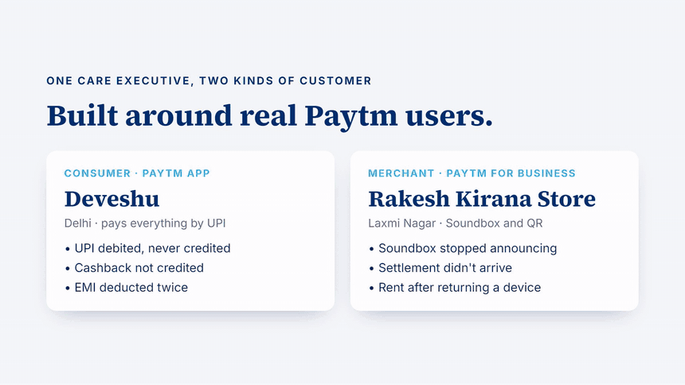

# Closr

**Closes tickets. Closes deals. Closes the loop.**

Closr is an AI teammate for Paytm customer care. It does not stop at answering: it understands the customer, acts in Paytm's systems inside policy written as code, verifies every result against the source record, and brings in a human only when judgement is needed. Customers reach it on a live phone call in Hinglish, or by chat inside the Paytm app, so customers who are deaf or hard of hearing get the same help.

Built for the Paytm Build for India AI Hackathon (Delhi), track *AI Teammates for Customer Service and Sales*, by Team KALESH.



- Demo video, 2:37 with voiceover: [docs/media/closr-demo.mp4](docs/media/closr-demo.mp4)
- Architecture and design decisions: [docs/ARCHITECTURE.md](docs/ARCHITECTURE.md)
- Judges' test guide: [How to test and verify](#how-to-test-and-verify)

## What it resolves

One Paytm care executive handles two kinds of customer from a single console.

| Customer | Problem | What Closr does |
|---|---|---|
| Consumer (Paytm app) | UPI payment debited but never credited | Finds the payment, explains the RBI reversal deadline (T+1 or T+5), raises a UDIR dispute with NPCI. It never promises Paytm will pay what the bank owes. |
| Consumer | Bank says success, but the receiver says the money never arrived | Flags the payment as under investigation and raises a credit-not-received dispute instead of arguing that it succeeded. |
| Consumer | Cashback not credited | Checks the offer terms and credits it; above the limit a specialist approves in one tap. |
| Consumer | Loan EMI deducted twice | Routes the case to the lender's grievance officer with the RBI 30-day clock; Paytm cannot refund a lender's money. |
| Merchant (Paytm for Business) | Soundbox stopped announcing payments | Confirms every payment that arrived, restarts the device remotely, updates firmware and plays a one rupee test announcement. |
| Merchant | Settlement did not reach the bank | Re-sends a settlement that failed for a technical reason and confirms the UTR. Bank details are never changed in a conversation. |
| Merchant | Rent charged after returning a device | Refunds rent charged after the pickup date and stops billing; above the limit a specialist approves. |
| Both | Issue fixed, customer satisfied | Offers at most one product that stops the problem recurring (UPI Lite, a dual-SIM Soundbox). The customer accepts it only in the app; nothing is charged in the conversation. |

Every dispute schedules a follow-up: the case closes only when the money has actually landed and the customer has been told.

## Built for trust

- **Policy as code decides, not the model.** Every money movement passes a deterministic policy check, shown to the care team as a checklist.
- **Earned autonomy, per workflow.** A trust dial sets each money workflow to L0 Shadow (Closr suggests, a specialist acts), L1 Approve (every payout waits for one tap), L2 Auto within limits, or L3 Autonomous for workflows with proven accuracy. L3 lifts only the amount limit: eligibility, duplicate protection and risk reviews still apply.
- **Nothing pays twice.** Every action is idempotent per subject, so a repeated turn on a call returns the same refund or dispute.
- **Identity comes from the channel.** The customer is bound to the number Closr dialled or the signed-in app, never to what the model heard.
- **Claims are checked, not believed.** When a customer cites a rule ("RBI says 10 minutes"), Closr checks it against RBI, NPCI, government and Paytm sources only and answers with the source.
- **A teammate that learns.** Specialists coach Closr with "next time, do X"; every lesson reaches the next call and chat immediately.
- **Auditable.** Every call and chat exports as a transcript with its action log, and the Call Health view shows what the voice platform actually heard. Calls open with a recording notice.
- **Measurable outcomes.** The console tracks conversations, autonomous and verified resolutions, money returned, escalations and time to a verified fix.

## Architecture

```
Customer
  |-- phone call (Bolna: Sarvam Saaras v4 STT, Sarvam Bulbul v4 voice, OpenAI) --.
  '-- chat in the Paytm app (Sarvam sarvam-105b-conversations, OpenAI fallback) --+
                                                                                  v
                       Closr tools API   /api/tools/*   (src/lib/tools.ts)
                       policy check  ->  action  ->  verify  ->  moment
                                                                                  |
             UPI, disputes, rewards, lending, settlements, devices, billing, offers
                                                                                  |
             Care Console (/)   Customer view (/customer)   Call Health (/diagnostics)
```

Voice and chat share one behaviour spec, `src/lib/agent-spec.json` (playbook and tool definitions), so the two channels cannot drift apart. Details in [docs/ARCHITECTURE.md](docs/ARCHITECTURE.md).

**Stack:** Next.js 15 (App Router), TypeScript, Tailwind CSS v4, Bolna voice agents, Sarvam (speech and the chat model), OpenAI (voice reasoning, claim checks and web search), a file-backed JSON store for the simulated back office.

## Run it locally

Requires Node 22 or later.

```bash
npm install
cp .env.example .env.local
npm run build
npm run start
```

Open http://localhost:3000 for the Care Console and http://localhost:3000/customer for the customer app. Chat works with only `SARVAM_API_KEY` or `OPENAI_API_KEY` set; phone calls also need Bolna (below).

### Environment variables

| Variable | Required for | Notes |
|---|---|---|
| `SARVAM_API_KEY` | Chat | Chat brain (`sarvam-105b-conversations`) |
| `OPENAI_API_KEY` | Claim checks, web search, chat fallback | Also used by the Bolna agent if added to Bolna |
| `BOLNA_API_KEY`, `BOLNA_AGENT_ID` | Phone calls | `BOLNA_AGENT_ID` is printed when you create the agent |
| `TOOLS_SECRET`, `WEBHOOK_SECRET` | Phone calls | Shared secrets Bolna presents to the tools and webhook; any long random strings |
| `CONSOLE_KEY` | Hosted deployments | Unlocks the console when it is not served from localhost |
| `PUBLIC_CONSOLE` | Optional | `true` opens a hosted console without a key, for a public demo with seeded data |
| `DEMO_CUSTOMER_NAME` | Optional | Name of the demo consumer |

## Deploy on Render

1. Create a **Web Service** from this repository (or use the included `render.yaml` blueprint).
2. Build command: `npm ci && npm run build`. Start command: `npm run start:render`. Node 22.
3. Set the environment variables above, including a long random `CONSOLE_KEY`.
4. Open `https://<your-service>.onrender.com/?key=<CONSOLE_KEY>` once (or set `PUBLIC_CONSOLE=true` for an open demo). The key is stored as a secure cookie, so the console, `/customer` and `/diagnostics` then open normally in that browser.

The console is served only on localhost unless the console key is presented; the tool and webhook routes answer only with their own secrets. Demo data lives in `.data/` on the instance and can be reset from the console menu.

### Connect the voice agent (Bolna)

With the app reachable at a public URL (your Render URL, or `ngrok http 3000` locally):

```bash
node --env-file=.env.local scripts/bolna-agent.mjs https://<public-url>
```

The first run creates the agent and prints its id; put it in `BOLNA_AGENT_ID` and run again to update it. On a Bolna trial account, calls reach only numbers verified in your Bolna dashboard.

## How to test and verify

Use two browser windows side by side: the **Care Console** (`/`, add `?key=<CONSOLE_KEY>` on a hosted deployment) and the **customer app** (`/customer`). Before you start, open the console menu (top right) and choose **Reset demo data and clear call history**.

**1. Chat, no phone needed (consumer).** In `/customer`, tap **Chat with Closr** and send, one at a time:
- `Kal Gupta General Store ko 850 rupaye bheje, kat gaye par dukaan wale bol rahe hain mila hi nahi`
  Expect: the payment flips from Success to **Flagged** in the console UPI tab, a credit-not-received dispute appears under Disputes, and a follow-up is scheduled.
- `RBI ka rule hai ki 10 minute mein paisa wapas aana chahiye na?`
  Expect: a **Claim check** card with an RBI or NPCI source and the real rule (T+1 or T+5).
- `Accha theek hai, shukriya` then `Haan bhej do`
  Expect: one UPI Lite offer, sent to the app, with nothing charged (Offers tab shows Sent).

**2. Human in the loop.** Open **Trust dial, Adjust** in the console and set **Cashback** to **L1 Approve**. In a new chat send `Mera flight ka 750 rupaye cashback nahi aaya`. An approval card and toast appear; press **Approve** within 20 seconds and watch the cashback get credited and verified. Set it to **L3 Autonomous** and a payout above the limit goes through without asking, while an account with a risk flag still needs a person.

**3. Merchant.** Switch the customer app to **Paytm for Business**, chat with `Soundbox subah se bol nahi raha, paisa aaya ki nahi?` and then `Card Soundbox lauta diya tha, phir bhi rent kat raha hai`. Expect payments confirmed, the Soundbox restarted and updated with a test announcement, and a rent refund that asks for one-tap approval above Rs 1,000.

**4. Phone call (needs Bolna).** In the console pick a profile, enter a verified mobile number and press **Call customer**. Speak the same issues in Hinglish. Every step appears live in the console and the customer app.

**5. Close the loop and audit.** In the console back office open **Follow-ups** and press **Run due follow-ups now**: the disputed money is reversed and the customer is notified. Open **Call history** to download a transcript, or the pulse icon for **Call Health**. Use **Coach Closr** to add a lesson, then start a new chat and see it applied.

The outcomes strip at the top of the console updates as you go.

## Project layout

```
src/lib/          tools, policy, store, seed data, chat engine, claim checks, Bolna client, metrics
src/app/api/      tools for the agent, call and chat endpoints, state, approvals, autonomy, lessons, follow-ups, transcripts, diagnostics
src/components/   Care Console, customer app (call back and chat), moments timeline, back office
scripts/          the Bolna voice agent, defined in code
docs/             architecture, demo video and GIF
```

The back-office systems are realistic simulations seeded with demo data; in production they would be Paytm's own services behind the same tool interface.

## Team

Team KALESH, Deveshu Pathak.
